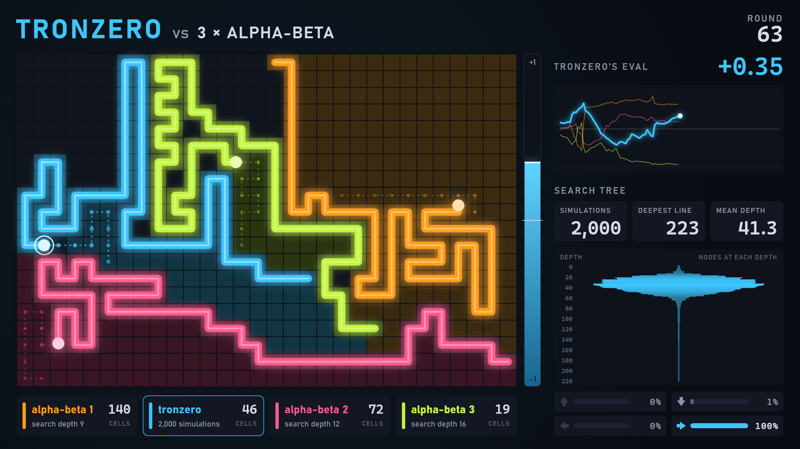

# tronzero

An AlphaZero-style agent for [CodinGame Tron Battle](https://www.codingame.com/multiplayer/bot-programming/tron-battle)
(two to four players), built on the lessons of slinky's AlphaZero. A small
network gives move priors and a value for every player, a PUCT search plays
with them, and the network learns from the search's own self-play games.

The game, the network's forward pass and the search are a dependency-free Rust
engine (`engine/`), used for self-play and for play. JAX only trains
(`train/`), on the AMD GPU through ROCm in WSL. Design, diagrams and results:
`writeup/tronzero-notes.html`.



The alpha-beta engine this repository began as is in `legacy/alpha-beta/`,
unchanged. tronzero still leans on it: its referee and viewer
(`legacy/alpha-beta/tools/sprt.py`, `watch.py`) run every timed match here,
and its engine is the opponent tronzero is measured against.

## Layout

```
engine/src/board.rs   the game (30x20, 2-4 players, sequential turns, a dead bike's
                      trail leaves the board), bitboard floods, distances, the fill
                      estimators ported from the alpha-beta engine
engine/src/net.rs     the forward pass (AVX2/FMA), computed only where the board is
engine/src/mcts.rs    max^n PUCT search, Dirichlet root noise
engine/src/play.rs    choosing a move within a time limit; the CodinGame stdin/stdout loop
engine/src/main.rs    commands: selfplay, match, vsbase, openings, bench, dump, check,
                      fillbench; with no command, the CodinGame loop
tools/make_paste.py   builds the single-file CodinGame submission
tools/paste_check.py  checks a build of the paste against the engine, move for move
tools/gate.py         new build against old build: the test a change has to pass
tools/record_game.py  records the agent against alpha-beta bots, with its search statistics
tools/video_server.py serves video/replay.html and saves what it exports
tools/cg.py           CodinGame's API: test games on its machines, submitting, the ranking
paste/                tronzero_paste.rs (the submission) and the weights it embeds
arena/                submissions.jsonl: what each CodinGame submission was and how it ended
gate/                 prev/ (the frozen baseline), dev/ (the candidate), logs/ (every result)
openings/             balanced_2p.json, balanced_4p.json: spawns the frozen engine rates even
video/                replay.html (replay page, MP4 export), games/ (recordings), out/
train/tz.py           network, features and loss in JAX; weight export
train/loop.py         the generation loop: self-play -> train -> export
train/parity.py       checks the Rust forward pass against the JAX one
build.sh              builds the engine into bin/tronzero-dev.exe
wsl.sh                runs a command in WSL with the JAX/ROCm environment
bench_vs_baseline.sh  the agent against the alpha-beta engine through sprt.py
legacy/alpha-beta/    the alpha-beta engine (Rust), its SPRT referee and its viewer
runs/<name>/          nets/<gen>.bin, data/<gen>.bin, metrics.jsonl, train.log
snapshot-2p/          the earlier two-player-only engine and trainer (source)
```

`runs/n1` is the 2-4 player run. `runs/r1` is the earlier two-player run; its
networks are in the older `TZN1` format, which only `bin/tronzero-2p.exe`
reads.

Not in the repository: anything built (`bin/`, the engine and network copies
in `gate/prev` and `gate/dev`, whose `ABOUT.txt` say what they were), the
self-play data and trainer state of the runs (`runs/*/data`, `ckpt.pkl`), all
of `runs/r1`'s networks but the last, and exported videos (`video/out/`).

## Run

Build (Git Bash; needs Rust on Windows):

```bash
bash build.sh            # -> bin/tronzero-dev.exe
bash build.sh promote    # also replace bin/tronzero.exe, the copy a training run executes
# the alpha-beta engine, the opponent in every timed match
cargo build --release --manifest-path legacy/alpha-beta/Cargo.toml
cp legacy/alpha-beta/target/release/tron.exe bin/tron-baseline.exe
```

Train (the loop runs in WSL and starts the Windows engine through interop):

```powershell
wsl -d Ubuntu-24.04 -e bash <workspace>/wsl.sh python train/loop.py --run runs/n1
```

Running it again resumes from `runs/n1/ckpt.pkl`; flags given on resume
override `config.json` (for example `--lr 3e-4`). `touch runs/n1/PAUSE` holds
the loop between generations, `touch runs/n1/STOP` ends it after the current
one. Self-play games are two-, three- and four-player in the ratio `--mix`
(default `1,1,3`).

Measure (`--players 2|3|4` everywhere; the default is 2):

```bash
# in process, equal ms per move: one agent against copies of the alpha-beta engine,
# every opening played with the agent starting from each seat
./bin/tronzero-dev.exe vsbase --net runs/n1/nets/0040.bin --players 4 --pairs 100 --budget-ms 20 --threads 8
# the same match through the alpha-beta engine's referee (separate processes on pipes)
bash bench_vs_baseline.sh runs/n1/nets/0040.bin --players 4 --fixed --max-games 240 --budget-ms 20 --concurrency 8
# network against network at fixed simulations
./bin/tronzero-dev.exe match --a runs/n1/nets/0040.bin --b runs/n1/nets/0020.bin --players 4 --pairs 200 --sims 64
# evaluation speed
./bin/tronzero-dev.exe bench --net runs/n1/nets/0040.bin
```

`score` is the mean placement score over openings: 1 for winning, 0 for being
the first out, evenly spaced between, so 0.5 is parity (in a duel it is the
win rate). `win_rate` is the share of games won; `win_rate_at_par` is what
equal engines would get (1/N for one agent among N).

Pause the training loop before a timed match: both engines think for wall-clock
milliseconds.

Check the engine after changing it:

```powershell
./bin/tronzero-dev.exe check        # rule invariants on random 2-4 player games
wsl -d Ubuntu-24.04 -e bash <workspace>/wsl.sh python train/parity.py bin/tronzero-dev.exe runs/parity
```

## Testing a change

One change at a time, new build against old build, as crossfish does it.
`gate/prev` is a frozen copy of the engine and network the CodinGame paste was
built from. A candidate is staged in `gate/dev` and has to beat it:

```bash
python tools/gate.py dev --note "what changed"                      # bin/tronzero-dev.exe + network -> gate/dev
python tools/gate.py screen --players 4 --seed 301                  # fixed simulations, in process
python tools/gate.py screen --players 2 --seed 302
python tools/gate.py run --players 4 --seed 303                     # the referee, on the clock
python tools/gate.py freeze --force --note "what was accepted"      # the candidate becomes the baseline
```

Both stages are sequential tests (SPRT) and report Elo with a 95% interval.
A test stops as soon as the result is clear, accepting H0 (the new side is
worth `--elo0`, 0 by default) or H1 (`--elo1`, 10 by default) with 5% error
rates, and stops undecided at a cap (`--openings`, `--games`). `--fixed`
plays the whole cap instead and passes only if the whole interval is above 0.
For a change that should cost nothing, test `--elo0 -10 --elo1 0`.

- `screen` plays `tronzero match` at the simulations a CodinGame turn gives
  (1,250 a move with four players, 1,550 with three, 1,800 in duels;
  `--sims` overrides), every opening from every seat, and looks at the
  result every 25 openings (100 in duels). It compares two networks or two
  search settings inside one build; a setting needs no rebuild
  (`-- --c-puct-a 0.6 --c-puct-b 1.0`). It does not depend on the clock, so
  other work may run beside it.
- `run` plays the two builds as separate processes through the referee,
  `legacy/alpha-beta/tools/sprt.py`, which runs the SPRT itself: one
  candidate against copies of the baseline, at 52 ms a move with 7 games at
  once. Under that load this desktop runs the engine at 1.6 to 2.0 times
  CodinGame's speed, so 52 ms stands for CodinGame's 95 (see "CodinGame
  arena"). Nothing else should be running.
- Elo is the logistic of the score, as `sprt.py` converts it: of the mean
  placement score in `screen` (0.5 is level; the two sides share each table)
  and of the candidate's win rate against the field in `run` (1/players is
  level). The two scales measure different things; do not add them. The
  interval comes from the spread between openings, each counted once.
- How long a test takes depends on the spread. A four-player opening in
  `screen` spreads about 46 Elo, so SPRT[0,10] decides in about 125 openings
  when the truth sits on either bound; a duel opening spreads about 195 Elo
  and needs about 2,200. In `run` a four-player game is a win or a loss:
  10 Elo takes about 9,000 games, 20 Elo about 2,200, 40 Elo about 500, so
  the referee stops early only on clear differences.
- Give every test a seed that has not been used, and decide the bounds
  before looking: a first reading of +20 Elo for a lower exploration
  constant shrank to +7 on fresh openings.
- Every result is appended to `gate/logs/results.jsonl`.

Accepted so far, each against the build before it:

| Change | Four players, 2,000 simulations | Duels, 2,000 simulations | Referee, four players at 56 ms |
|---|---|---|---|
| Exploration constant 0.6 for 1.0 (14 Nov 2026) | +8.0 +/- 6.4 Elo, 1,200 games | +11.6 +/- 22.1 Elo, 600 games | +6.1 +/- 20.5 Elo, 1,200 games |

That first test was run at fixed length, before the gate ran SPRTs, and
before its settings were measured on CodinGame: at 2,000 simulations where a
four-player turn there gives 1,250, and at 56 ms where 52 is the match. The
referee neither confirms nor contradicts so small a gain; it showed that the
change costs nothing on the clock (61 simulations per ms against 63).

Tested again at CodinGame's speed, four players at 1,250 simulations, as an
SPRT on fresh openings (seed 304): +8.5 +/- 6.5 Elo over 1,650 games on 275
openings, where the test stopped and accepted H1.

Duels start from `openings/balanced_2p.json`, spawns the frozen engine rates
within 0.15 of even (`python tools/gate.py books` rebuilds the books). The
network calls most random duel spawns nearly decided (median |value| 0.89;
1 in 21 is within 0.15), and a decided spawn says nothing about a change:
doubling the simulations from 1,000 to 2,000 measured +12 +/- 16 Elo from
random spawns and +74 +/- 28 from the book over the same 400 games. With
four players the book made no difference (+16 +/- 11 against +13 +/- 8), so
three- and four-player tests start from uniform spawns, as CodinGame does.

## Replay and video

`tools/record_game.py` plays the agent against alpha-beta bots on the
alpha-beta engine's referee, driven as its viewer
(`legacy/alpha-beta/tools/watch.py`) drives it but without a window, and writes each game to
`video/games/` with what the agent printed about every search: its value for
each bike, the tree's size and depth, the nodes at each depth, the visits of
the root moves and the line it expects.

```bash
python tools/record_game.py --games 32 --seed 1 --concurrency 4    # one JSON line per game: who won, how long
python tools/video_server.py                                       # then open http://localhost:8765/replay.html
```

The page plays a recording back: the board with each bike's reach shaded, the
moves the agent expects as dots, its evaluation as a bar and a history, the
shape of its search tree, and the visits of its four moves. Space plays and
pauses, the arrow keys step. Once the agent has run its last search (it is
walled off and only fills its space) the rest of the game plays three times
faster. `Export MP4` encodes the replay in the browser (H.264, 1920x1080, 30
frames a second) and saves it to `video/out/`; `Save frame` saves a PNG. The
export needs a Chromium browser, for its video encoder.

The agent thinks for a fixed 2,000 simulations a move in a recording (a
CodinGame turn gives it 1,250 with four bikes alive), so a game does not depend on what else the
machine is doing; the bots get `--budget-ms`, 100 by default. The agent's
statistics come from a line it prints when `TZ_STATS` is set; that code is
left out of the paste.

## Play

`tronzero-dev.exe` with no command speaks the CodinGame protocol for two to
four players, as the alpha-beta engine's binary does (`--budget-ms N` or
`TRON_BUDGET_MS`). It reads the network from `--packed` (the text the paste
embeds), then `--net`, then `TRONZERO_NET`, then `net.bin` beside the
executable. `--sims N` or `TRON_SIMS` replaces the time limit with a fixed
number of simulations per move, which makes its play repeatable.

## CodinGame paste

`paste/tronzero_paste.rs` is the submission: one Rust file of 95,566
characters (CodinGame allows 100,000) holding the engine and the weights of
`runs/n1/nets/0040.bin`. Paste it into the Tron Battle IDE with the language
set to Rust, or send it with `tools/cg.py` (see "CodinGame arena").

Build it again after changing the engine or the network:

```bash
python tools/make_paste.py --net runs/n1/nets/0040.bin    # -> paste/tronzero_paste.rs, net_packed.txt, net_q.bin
rustc --edition 2021 -C opt-level=3 -o bin/tronzero-paste.exe paste/tronzero_paste.rs
rustc --edition 2021 -o bin/tronzero-paste-debug.exe paste/tronzero_paste.rs    # unoptimised, as CodinGame's IDE builds it
```

The generator wraps `engine/src/{board,net,mcts,play}.rs` in modules, drops
comments, indentation and the regions between `// paste:skip-begin` and
`// paste:skip-end` (code only training and measuring use), and appends the
weights as one string. Weights are rounded with one scale per output unit, to
7 bits in the hidden layer and 12 bits elsewhere (`--bits`, `--small-bits`),
and written 14 bits per character as CJK ideographs, because CodinGame counts
characters and not bytes. `paste/net_q.bin` is the rounded network as a
float32 file, for measuring it with the engine's own commands.

Check a build:

```bash
# the frame reader's regression case, then the same moves as the engine with
# the same weights at a fixed number of simulations
python tools/paste_check.py --a bin/tronzero-paste.exe --b "bin/tronzero-dev.exe --net paste/net_q.bin" --games 12 --sims 200
# the plain-loop kernels, which run where the CPU lacks AVX2 or FMA
python tools/paste_check.py --a bin/tronzero-paste.exe --env-a TZ_SCALAR=1 --b "bin/tronzero-dev.exe --net paste/net_q.bin"
# time per turn at its own budget, measured from outside the process
python tools/paste_check.py --a bin/tronzero-paste.exe --games 6
# against the alpha-beta engine through the referee (the paste ignores the network argument)
DEV=bin/tronzero-paste.exe bash bench_vs_baseline.sh runs/n1/nets/0040.bin --players 4 --fixed --max-games 240 --budget-ms 20 --concurrency 8
# the rounded network against the float one
./bin/tronzero-dev.exe match --a paste/net_q.bin --b runs/n1/nets/0040.bin --players 4 --pairs 200 --sims 64
```

Measured for the paste built from generation 40, on this machine:

- Compiles without warnings on Rust 1.59 and 1.97, editions 2018 and 2021.
- Same moves as the engine at a fixed number of simulations: 0 of 2,740
  differ (optimised, plain-loop kernels, unoptimised, edition 2018).
- Time per turn from outside the process: at most 95.3 ms, 86.1 ms on the
  first turn, the unoptimised build included (1,363 turns, none over 100 ms).
- Simulations in the first turn of a four-player game: 2,733 optimised, 1,282
  with the plain loops, 18 unoptimised.
- Rounded weights against the float ones at 64 simulations per move:
  0.4975 ± 0.007 with four players (1,800 games), 0.515 ± 0.012 in duels
  (1,200 games).
- Through the referee, four players at 20 ms, 240 games on each of three
  opening seeds: the paste won 219 of 720 (30.4%: 69, 73, 77), the engine
  with the float weights 243 of 720 (33.8%: 87, 74, 82); par is 25%. No
  timeout, illegal move or crash with a move available in those 1,440 games.
  The 3.3-point difference is inside the noise of that sample (about ±4.7),
  and nothing measured explains a real one: the two play the same moves at
  equal simulations and the paste gets 3% fewer simulations in a 20 ms turn.

The referee also exposed a bug in the CodinGame loop that the engine had
since the move to four players: a frame in which one bike is newly out and
another stands on a cell the first one's trail vacated was read in bike
order, so the new head was placed and then erased with the dead trail. The
loop now removes the bikes that are out before it places heads, and
`paste_check.py` starts with a scripted position that fails on the old loop.
Referee results from before 14 Nov 2026 were played with that bug; the
in-process `vsbase` matches never used the loop.

When submitting:

- `TURN_BUDGET_MS` (95) and `FIRST_TURN_BUDGET_MS` (80) at the top of the
  paste are the thinking time per turn. Lower them if a turn ever times out.
- Every searched turn prints `DIR mm SCORE Tms n=SIMS d=0 a=ALIVE` to stderr;
  `n` is the number of simulations CodinGame's machine managed.
- Test games started through CodinGame's API run an optimised build: about
  1,050 simulations in the first turn. crossfish's notes say the IDE compiles
  Rust without optimisation; a few dozen simulations per turn would be the
  sign of that.
- The kernels use AVX2 and FMA when the CPU reports them and plain loops at
  about half the speed otherwise.

## CodinGame arena

`tools/cg.py` talks to CodinGame's public API
(https://www.codingame.com/api/v1/docs). It signs in once through the
browser, runs test games on CodinGame's machines, submits the paste and reads
the ranking. The token is kept in `~/.config/codingame/token` and can be
revoked at https://www.codingame.com/settings/tokens.

```bash
python tools/cg.py login       # prints a link and a code to approve in the browser
python tools/cg.py wait        # saves the token once the code is approved
python tools/cg.py test paste/tronzero_paste.rs --opponents default,default,default --stderr 3
python tools/cg.py submit paste/tronzero_paste.rs    # replaces the arena submission
python tools/cg.py follow      # the ranking, until every ranking game is played
python tools/cg.py battles     # placements of the current submission, by table size
```

A submission replaces the one in the arena and its score starts again from
nothing. CodinGame keeps no score history, so `arena/submissions.jsonl`
records what each submission was and how it ended.

| Submitted (UTC) | Commit | What | Score | Rank |
|---|---|---|---|---|
| 14 Nov 2026 16:42 | `eee4a11` | generation 40, exploration constant 1.0 | 37.17 | 1 of 8,285 |
| 14 Nov 2026 21:51 | `67cd001` | exploration constant 0.6 | 37.15 | 1 of 8,285 |

Each took about 1,600 ranking games over an hour and forty minutes. The
arena cannot tell the two apart: in its four-player games the second placed
+8 +/- 19 Elo above the first by mean placement and -8 +/- 29 by first
places (29.6% then 28.6%), against opponents drawn afresh each time. A gain
of the size the gate measured, +8.5 +/- 6.5, needs the gate to see it.

Measured on CodinGame's machines in seven test games on 14 Nov 2026, from
the `n=` the paste prints:

- Simulations in a 94 ms turn, medians: 1,250 with four bikes alive (71
  turns of one game), 1,552 with three (45 turns), 1,827 with two (148
  turns). The opponents were the bots ranked 2 to 4.
- First turn, about 76 ms including unpacking the weights: 982 to 1,111 with
  four players (five games), 1,377 in a duel.
- No error and no late move in 762 turns.

The same engine on this desktop:

- One game alone: 2,733 simulations in the first turn, about 2.5 times
  CodinGame.
- Seven at once, as the gate's referee stage runs them: a median of 1,500
  simulations in a 56 ms first turn with four players and 1,736 in a duel.
  Per ms that is 2.0 and 1.6 times CodinGame, where crossfish measured 1.69
  for its own engine under the same load.

So the referee stage's old 56 ms was close: it gave a fifth more simulations
than CodinGame with four players and a twentieth fewer in duels. It is now
52 ms. The screens were further off: 2,000 simulations a move where a
four-player turn on CodinGame gives 1,250. They now play at the medians
above.

## Not done

- Not known: which Rust version CodinGame compiles with (the paste builds on
  1.59 and 1.97, editions 2018 and 2021), and how fast the arena's own
  machines are: ranking games carry no stderr, so the figures above come from
  test games only.
